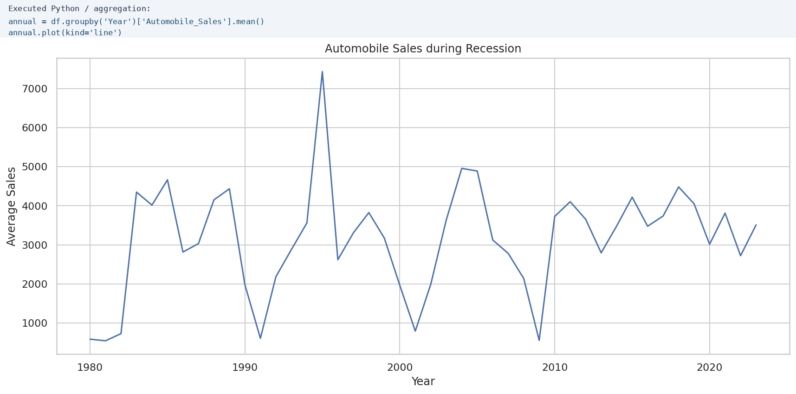

# YOUR_FULL_NAME — Data Science Portfolio

Welcome to my data science portfolio. I am developing practical skills in data analysis, visualization, dashboard development, and communicating evidence-based findings. This portfolio documents selected coursework and demonstrates how I use Python to transform data into clear analytical results.

## Technical Skills
**Python · pandas · NumPy · Matplotlib · Seaborn · Plotly · Dash · Jupyter Notebook · Data Cleaning · Exploratory Data Analysis · Data Visualization · Git/GitHub**

---

## Project Showcase

### Automobile Sales During Recession

**Research question:** How do recession periods affect automobile sales, and how are sales patterns related to wider economic and market factors?

**Finding:** The year-by-year analysis shows substantial changes in average automobile sales across the observation period. Recession-focused comparisons indicate that weaker economic conditions can coincide with lower sales, while variables such as unemployment, GDP, consumer confidence, vehicle type, and advertising expenditure help explain the market context.

**Limitation:** This exploratory analysis identifies associations in the supplied course dataset; it does not establish causal relationships or guarantee that the results generalize to the entire automobile industry.

**Project repository:** [View the complete project on GitHub](https://github.com/YOUR_GITHUB_USERNAME/data-science-project)

**Current status:** Completed

---

## About This Portfolio
This portfolio demonstrates my ability to organize a reproducible data science project, document methods and limitations, create readable visualizations, and communicate findings through a public GitHub Pages website.

_Last updated: October 2026._
